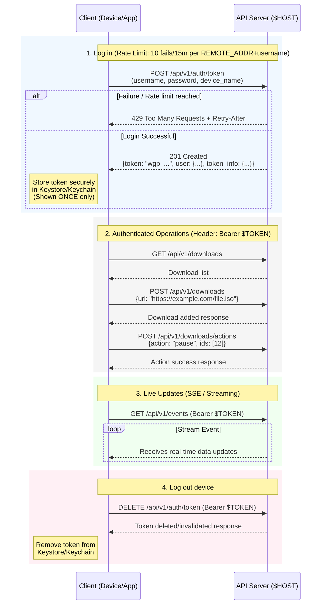

# Mobile / third party API (v1)

Machine readable description: `GET /api/v1/openapi.json`. Auth is a **bearer token per device**; browser sessions and
cookies are ignored by `/api/v1/*` (so no CSRF token is needed).

## Why SSE and no push service

Downloads run on the server, the phone only *shows* them. One long-lived HTTP connection (Server-Sent Events)
carries status changes and progress, so the app needs **no Firebase, no ntfy / UnifiedPush app, no extra install**.
Trade-off: the phone must keep that connection open.

* **Android**: run the SSE client in a *foreground service* (persistent notification) and update the progress
  notification from `progress` events. This is what keeps it alive in the background.
* **iOS**: there is no equivalent long-running background service; SSE works while the app is in the foreground.
  Notifications while backgrounded need APNs (not implemented, see "Not included").

## Flow

```bash
# 1. log in (rate limited: 10 failures / 15 min per REMOTE_ADDR+username -> 429 + Retry-After; see README limitation behind proxies)
curl -s -X POST $HOST/api/v1/auth/token -H 'Content-Type: application/json' \
     -d '{"username":"me","password":"…","device_name":"Pixel 8"}'
# -> 201 {"token":"wgp_…","user":{…},"token_info":{…}}      the token is shown ONCE, store it in the Keystore/Keychain

# 2. everything else
curl -s $HOST/api/v1/downloads -H "Authorization: Bearer $TOKEN"
curl -s -X POST $HOST/api/v1/downloads -H "Authorization: Bearer $TOKEN" -H 'Content-Type: application/json' \
     -d '{"url":"https://example.com/file.iso"}'
curl -s -X POST $HOST/api/v1/downloads/actions -H "Authorization: Bearer $TOKEN" -H 'Content-Type: application/json' \
     -d '{"action":"pause","ids":[12]}'

# 3. live updates
curl -N $HOST/api/v1/events -H "Authorization: Bearer $TOKEN"

# 4. log out this device
curl -s -X DELETE $HOST/api/v1/auth/token -H "Authorization: Bearer $TOKEN"
```



[](https://raw.githubusercontent.com/licface15/images/refs/heads/main/wgetpanel/wgetpanel_architeture.jpg)

Errors: `{"error":{"code":"…","message":"…"}}` with 400 / 401 / 404 / 429 / 503.
Tokens expire after `WGP_TOKEN_TTL_DAYS` (default 180, 0 = never); `GET /api/v1/auth/tokens` lists devices and
`DELETE /api/v1/auth/tokens/{id}` revokes one.

## Event stream (`GET /api/v1/events`)

| event | when | payload |
|---|---|---|
| `snapshot` | first event of every connection | same as `GET /api/v1/downloads` |
| `status` | immediately on every transition (queued, running, paused, completed, error, canceled) | `id, status, filename, error, downloaded, total, exit_code, ts` |
| `removed` | download deleted | `id` |
| `progress` | about once per second, only while something is running | `items[{id, downloaded, total, speed}], speed` |

* Staff receive events of all users, everybody else only their own.
* Lines starting with `:` are keep-alives (every 15 s), ignore them.
* The server closes the stream after `WGP_SSE_MAX_SECONDS` (default 1 h) or when the token is revoked. **Reconnect
  with backoff**; the first event after reconnecting is a full `snapshot`, so the client never has to replay missed events.
* Use `status` events for "finished / failed" notifications and `progress` for the progress bar (throttle
  notification updates to ~1 per second, Android rate-limits notification updates).
* Behind nginx: `proxy_buffering off;` (the response already sends `X-Accel-Buffering: no`) and a read timeout above 15 s.
* Capacity: one open stream = one gunicorn thread (`GUNICORN_WORKERS` x `GUNICORN_THREADS`, default 3 x 32 = 96).
  Streams do not keep a PostgreSQL connection open.

## Flutter sketch (NOT compiled or run, check package versions before use)

```dart
// pubspec: http, flutter_secure_storage, flutter_local_notifications, flutter_foreground_task
final req = http.Request('GET', Uri.parse('$host/api/v1/events'))
  ..headers['Authorization'] = 'Bearer $token'
  ..headers['Accept'] = 'text/event-stream';
final resp = await http.Client().send(req);
String? event;
await for (final line in resp.stream.transform(utf8.decoder).transform(const LineSplitter())) {
  if (line.startsWith('event: ')) { event = line.substring(7); }
  else if (line.startsWith('data: ')) { handle(event, jsonDecode(line.substring(6))); }
}
// on error/close: wait with exponential backoff, reconnect, the first event is a fresh snapshot
```

## Resumable file download

`GET /api/v1/downloads/{id}/file` supports `Range: bytes=N-` (answer `206` + `Content-Range`), suffix ranges (`bytes=-500`),
`If-Range` and `HEAD`. Recommended client flow: `HEAD` for `Content-Length`, `ETag` and the file name; keep the partial
file together with the ETag; to resume send `Range: bytes=<have>-` and `If-Range: <etag>`. A `206` means append, a `200` means the
file changed (or ranges are not honoured): start again from zero; `416` means the partial file does not fit. Multiple ranges in
one header are answered with the whole file.

## Notifications of the signed-in user

`GET /api/v1/notify` returns the caller's settings (ntfy topic and `subscribe_url`, GNTP receiver, events, retry-notice
interval, server defaults and whether ntfy / GNTP are available on this server). `POST /api/v1/notify` updates them (partial):
`ntfy_enabled`, `rotate_topic`, `gntp_enabled`, `gntp_host`, `gntp_port`, `gntp_password`, `clear_gntp_password`, `events`
(`null` = server default), `retry_interval` (`null` = server default, `0` every retry, `-1` never), `enabled`. Invalid input
answers `400 {error: {code: "invalid_notify_settings", message}}` and changes nothing. `POST /api/v1/notify/test` sends a
test message to the caller's own targets (`{"target": "global"}` for staff: the server channel).

A mobile app can subscribe to its user's ntfy topic with its own ntfy client; or ignore push entirely and use the SSE stream.

## Other endpoints

* `POST /api/v1/downloads` accepts `retry` (`3`, `-1` / `"always"`, `0` / `"off"`; omit = server default). Rows carry
  `retry_max`, `retry_count`, `retry_limit`.
* `POST /api/v1/downloads/actions` accepts `delete_files` (omit = server setting) and answers
  `{affected, files_deleted, files_pending}`.
* Staff only: `GET/POST /api/v1/settings` (values + schema with types, bounds and help), `GET/POST /api/v1/rules`,
  `PATCH/DELETE /api/v1/rules/{id}`.

## Not included (yet)

* Push while the app is not running (iOS background, killed Android app): needs APNs / FCM, which requires
  credentials owned by whoever publishes the app. Deliberately left out of a self-hosted server.

